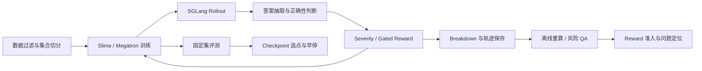

# 可审计的数学推理 GRPO 后训练系统

基于 **Slime / Megatron / SGLang** 的数学推理后训练复现与优化项目。围绕 reward hacking，构建从 Reward 设计、离线 QA、GRPO rollout、轨迹重算到固定集评测的实验流程，使奖励规则可解释、可检查，支持 checkpoint 选点与早停。

**技术栈：** Python · PyTorch · Slime · Megatron · SGLang · GRPO · Qwen2.5-1.5B

## 项目解决什么问题

当 accuracy、format、length 直接线性相加时，模型可能通过格式、冗长文本或投机表达获得奖励，掩盖答案错误。训练总分也难以说明“模型是否真正答对、为什么得分”。

项目从 **奖励结构、风险回归与 rollout 审计**三个环节入手，让正确性主导奖励，并保留能追踪到具体输出的评分分解。

## 主要工作

### 1. 迭代 Reward，减少辅助分补偿错误答案

分析线性叠加的可补偿漏洞，将 hedge、多候选答案、低信息、重复和 hack phrase 汇总为 **severity**，纳入 gated accuracy 主项；保留 correctness-gated format、length soft penalty 与 wrong-base penalty 作为辅助约束。

将答案抽取、数学表达式比较与 Reward 计算解耦，逐条输出 `parse_ok`、`correctness`、`severity`、`gated accuracy` 和 `raw reward`，便于定位异常得分。

### 2. 建立固定风险集，先做 QA 再进入训练

使用固定 **8 类风险回归案例**验证 round1–5 的 Reward 结构，覆盖错误答案、格式异常、投机话术、重复和截断；通过排序断言检查“正确回答是否优于错误/投机回答”，从 round3 起，所测错误样本正 Reward 数降为 0。

### 3. 接入训练与评测，形成可追溯实验流程

围绕 Qwen2.5-1.5B 接入 Slime reward adapter、数据转换、rollout 检查、保存输出的历史重算与固定集评测；使用与 SFT 不重合的 GRPO 样本并进行种子核验，结合准确率与 Reward 分解检查训练收益。

### 4. 结合错误类型做 checkpoint 选点

对保存的轨迹重算 Reward，区分答案解析失败、正确性下降和投机行为，形成 **Reward 准入 → 训练 → rollout audit → checkpoint 评估 → 选点/早停**流程。

## 系统架构



## 项目效果

项目阶段结果：

| 指标 | 结果 |
|---|---|
| MATH eval600 准确率 | **48.17% → 61.67%** |
| 正确题数 | **289/600 → 370/600，净增 81 题** |
| 正式 rollout audit | **positive-wrong-raw = 0** |
| 固定风险集 | 从 round3 起，所测错误样本正 Reward 数为 **0** |

项目阶段记录与附带的 sequential-greedy 复测分别列示，评测协议和文件对应见 [实验口径](docs/EXPERIMENTS.md)。

## 快速运行

Python 3.10+。先安装包及 SymPy 依赖；以下 CPU 检查无需模型和训练框架：

```bash
python3 -m pip install .

# 固定案例演示与 21 个回归检查
python3 -m own.scripts.demo
python3 -m own.scripts.test_reward_rounds --skip-rollout

# 风险 QA、五轮离线设计对照和历史指标汇总
python3 -m own.scripts.run_reward_qa --output-dir outputs/reward-qa
python3 -m own.scripts.run_reward_round_comparison --output-dir outputs/round-comparison
python3 -m own.scripts.summarize_eval600
```

GPU 训练、独立生成评测和保存输出重算的入口见 [复现说明](docs/REPRODUCE.md)。

## 代码导航

| 文件 | 内容 |
|---|---|
| `own/reward_rounds/answer_utils.py` | 答案抽取与受限表达式等价比较 |
| `own/reward_rounds/core.py` | Reward 主结构、severity 与分项得分 |
| `own/reward_rounds/qa_cases.py` | 固定风险案例 |
| `own/slime_adapters/round_reward.py` | Slime Reward 接口适配 |
| `own/scripts/inspect_round_rollout.py` | 对受信任的本地轨迹做 Reward 重算 |
| `evidence/` | 历史 QA、离线对照与评测摘要 |
